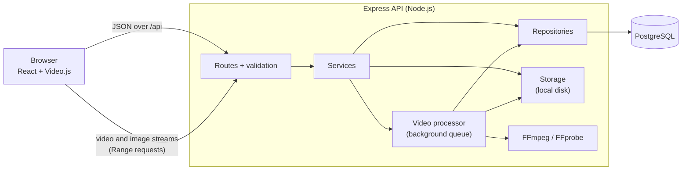
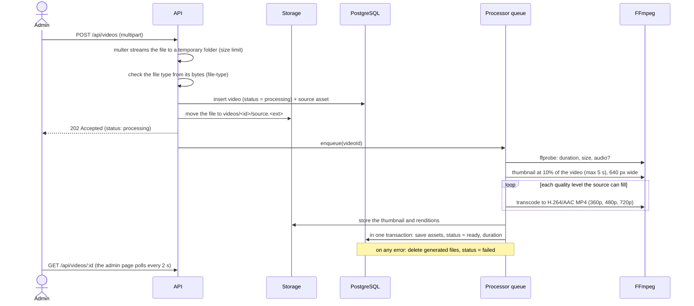

# Architecture

## Overview



The project is a monorepo (npm workspaces) with two packages:

- **`client/`**: a React single-page app built with Vite.
- **`server/`**: an Express REST API, backed by PostgreSQL and FFmpeg.

In development, Vite serves the app on port 5173 and forwards `/api` to the API on port 4000, so the browser sees a single origin.

## Backend

### Layers

Each feature lives in its own folder under `server/src/modules/`, split into the same layers:

| Layer      | File              | Responsibility                                                                          |
| ---------- | ----------------- | --------------------------------------------------------------------------------------- |
| Routes     | `*.routes.js`     | URLs, plus the middleware each route needs (auth, role, validation, upload, rate limit) |
| Schemas    | `*.schemas.js`    | Zod schemas for params, query and body. Inputs are trimmed, converted and checked here. |
| Controller | `*.controller.js` | Turns HTTP into service calls: reads `req.validated`, sets the status code              |
| Service    | `*.service.js`    | Business rules: who can see what, transactions, processing and storage                  |
| Repository | `*.repository.js` | SQL. Parameterised queries only, and rows mapped to camelCase objects                   |
| Presenter  | `*.presenter.js`  | The API response shape, e.g. building media URLs and signing them when needed           |

Each layer only calls the one below it, so business rules can be tested without HTTP and SQL stays in one place.

### Dependency injection

[`container.js`](../server/src/container.js) is the composition root: the only place where the pool, storage, video processor and services are created and connected. Every module is a factory that receives what it needs, for example `createVideosService({ pool, storage, videoProcessor })`. This lets tests build the app with a test database, and lets the storage driver change without touching feature code.

### Request pipeline

[`app.js`](../server/src/app.js) runs every request through these steps, in order:

1. `helmet`: security headers.
2. `cors`: only `CORS_ORIGIN`, with credentials.
3. Request logger (Pino): a request ID, and one structured log line per request.
4. JSON body parser (up to 1 MB), then the cookie parser.
5. The `/api` router.
6. 404 handler.
7. A central error handler.

Errors are thrown as `AppError` (with a status, code, message and details) and turned into JSON in one place. Postgres constraint errors are mapped to generic 400 or 409 responses. Anything unexpected becomes a 500 with a `requestId`, and the stack trace goes only to the logs.

### Configuration

[`config/env.js`](../server/src/config/env.js) checks every environment variable with Zod at startup. The process exits with a clear message if a variable is missing or invalid. The settings object is frozen and imported where needed. Secrets live only in `server/.env`, which git ignores. `.env.example` contains placeholders only.

## Video processing pipeline



Key points:

- **Uploads return right away (202).** Transcoding can take minutes, so it runs in the background. `VIDEO_PROCESSING_CONCURRENCY` (default 1) sets how many videos are processed at the same time.
- **Restarts are safe.** At startup, `resumePending()` re-queues every video still in `processing`. If processing fails, partial files are cleaned up and the video is marked `failed`.
- **Quality levels** are named after the short side of the frame, so portrait phone videos get the same 360p / 480p / 720p choices as landscape ones. Sources are never upscaled. A tiny source gets one rendition at its own size, and frame sizes are kept even, as H.264 requires.
- **FFmpeg runs safely.** It is started with `spawn` and a list of arguments (no shell), with `-protocol_whitelist file`, so a crafted media file can't make it open network URLs.
- **Room to scale.** The queue lives in memory. To process on separate worker machines, `enqueue()` can be replaced with a shared queue such as BullMQ on Redis; `processVideo()` stays the same.

### Storage

[`lib/storage/localStorage.js`](../server/src/lib/storage/localStorage.js) has a small interface: `put`, `toLocalPath`, `remove` and `tempDir`. Storage keys are relative (`videos/<id>/renditions/720p.mp4`), and the driver refuses any key that resolves outside its root folder. A cloud driver (e.g. S3) could implement the same interface without changing upload or processing code. Cloud storage was optional in the brief and is not implemented: all media stays on the local disk under `server/uploads/`, which git ignores.

### Streaming

Renditions and thumbnails are served with `res.sendFile`, which supports `Range` requests (seeking), ETags and `HEAD`.

| Video                | Caching                                | Access                                                     |
| -------------------- | -------------------------------------- | ---------------------------------------------------------- |
| Public and ready     | `Cache-Control: public, max-age=86400` | Anyone                                                     |
| Private or not ready | `private, no-store`                    | Admins, or a valid signed URL (HMAC, expires after 1 hour) |

### Search

The `q` text is broken into letters and digits only, up to 8 words, and turned into a prefix query (`react hoo` → `react:* & hoo:*`). Because only letters and digits are kept, user input can't inject `tsquery` operators. A video matches if its title or description matches (generated `tsvector`, GIN index) or if one of its tags matches a word. Results are ranked with `ts_rank`, title matches first.

## Frontend

```text
client/src/
├── app/          App.jsx (providers), routes.jsx (route table, shared with tests)
├── components/
│   ├── layout/   AppLayout, AppNavbar, UserMenu, ColorModeToggle
│   └── ui/       VideoCard, VideoGrid, DataTable, FormField, AppPagination, ConfirmDialog,
│                 ToastProvider, EmptyState, ErrorState, LoadingSpinner, PageHeader,
│                 SearchBox, VideoStatusBadge
├── features/     One folder per area. Each has its pages, components and an *Api.js file.
│   ├── auth/       Login, register, account, AuthProvider, RequireAuth / RequireAdmin guards
│   ├── videos/     Library: search, filters, sort, pagination
│   ├── watch/      Watch page, Video.js player, quality menu, like/bookmark/save actions, up next
│   ├── me/         Favourites, history, continue watching
│   ├── playlists/  My playlists, playlist page, save-to-playlist, reorder
│   └── admin/      Video table, upload, edit, thumbnail editor, delete
├── hooks/        useApi, useAsyncAction, useSearchParamsState, useDebouncedCallback,
│                 useColorMode, useDocumentTitle
├── lib/          apiClient, format helpers, form error mapping, pagination
└── styles/       Bootstrap theme (Sass variables) and global styles
```

### Patterns

- **Feature folders.** Code for one area stays together. `components/ui` holds only shared, presentational pieces with no API calls.
- **One API client.** [`lib/apiClient.js`](../client/src/lib/apiClient.js) does the following:
  - adds the access token to requests;
  - on a 401, refreshes once and retries the request (calls that arrive during a refresh wait for the same one);
  - turns error responses into `ApiError`;
  - reports upload progress through XHR.
- **Data hooks.** `useApi` loads data, with loading, error and retry states, and ignores responses that arrive out of date. `useAsyncAction` handles button actions: pending state, errors and toasts.
- **State in the URL.** Library search, filters, sort and page live in the query string (`useSearchParamsState`). Links can be shared, and the back button works.
- **Route guards.** `RequireAuth` and `RequireAdmin` protect routes, and the API also enforces every rule.
- **Smaller first load.** The watch page, which includes Video.js, is loaded lazily, so other pages never download the player. Only the Video.js core build is used.
- **Accessibility.** The UI follows WCAG 2.1 AA:
  - labelled form fields, with errors linked to their field (`aria-invalid` and `aria-describedby`);
  - focus moves into dialogs;
  - `aria-current` marks the current page in pagination;
  - one `h1` per page, and correct heading order;
  - colour contrast checked in both light and dark mode.

### Player

[`VideoPlayer.jsx`](../client/src/features/watch/VideoPlayer.jsx) wraps Video.js 8:

- **Speed:** 0.5×, 0.75×, 1×, 1.25×, 1.5× or 2×.
- **Quality menu:** a custom Video.js component. Switching quality keeps the position, speed and play/pause state. The choice is remembered for next time.
- **Starting quality:** the remembered choice if this video has it. Otherwise the best quality, capped at 480p on screens under 768 px wide.
- **Resume:** continues from the saved position, unless it is under 5 seconds or within 10 seconds of the end.
- **Progress:** for signed-in users, saved every 10 seconds during playback, and on pause, at the end and on leaving the page.
- **Views:** a view is recorded when playback starts.

## Security

| Concern              | Measure                                                                                                            |
| -------------------- | ------------------------------------------------------------------------------------------------------------------ |
| Passwords            | bcrypt (cost 12). Length limited to 72 bytes so bcrypt never silently truncates.                                   |
| Access tokens        | JWT (HS256), 15 minutes, held in memory only on the client                                                         |
| Sessions             | Refresh token in an `httpOnly`, `SameSite=Strict`, `Secure` (in production) cookie, path `/api/auth`               |
| Session theft        | Single-use, rotating refresh tokens. Reusing one revokes the whole session family. Only SHA-256 hashes are stored. |
| Brute force          | Login and register: 10 per IP per 15 minutes. View counting: 60 per minute.                                        |
| Authorisation        | `authenticate` + `authorize('admin')` middleware. Ownership is checked in services. Hidden resources return 404.   |
| Privilege escalation | Unknown body fields are stripped, so `role` can't be set at registration                                           |
| Input                | Every param, query and body is validated with Zod. Database `CHECK` constraints back this up.                      |
| SQL injection        | Parameterised queries only. Sort orders come from a fixed list.                                                    |
| Uploads              | Size limits. Type checked from the file's bytes. Server-generated file names. Temporary files deleted on error.    |
| Paths                | The storage driver refuses keys outside its root folder                                                            |
| Private media        | HMAC-signed URLs that expire, compared in constant time                                                            |
| Headers              | Helmet, and CORS limited to one origin                                                                             |
| Error leaks          | Generic messages. No SQL, table names or stack traces in responses.                                                |
| Logs                 | `Authorization`, cookies and URL signatures are removed from logs                                                  |
| Secrets              | Kept only in a git-ignored `.env` and checked at startup. `JWT_SECRET` must be at least 32 characters.             |
| Dependencies         | `npm audit` reports 0 known vulnerabilities in production dependencies                                             |

## Testing strategy

| Level              | Tooling                        | What it checks                                                                                                                                                    |
| ------------------ | ------------------------------ | ----------------------------------------------------------------------------------------------------------------------------------------------------------------- |
| Server integration | Vitest + Supertest             | Real HTTP requests against the app with a real PostgreSQL test database. Tables are emptied between tests. Includes real FFmpeg processing of small sample files. |
| Server unit        | Vitest                         | Pure logic: rendition planning, search query building, signed URLs, env checks, errors                                                                            |
| Client components  | Vitest + Testing Library + MSW | Pages rendered with the real route table. MSW mocks the API at the network level. Covers user flows (log in, upload, edit, playlists), guards and error states.   |
| Client unit        | Vitest                         | Playback rules, formatting, pagination, API client refresh logic                                                                                                  |
| API end-to-end     | Postman + Newman               | 72 checks over a full flow on the running API. Removes the data it creates.                                                                                       |
| Accessibility      | axe-core                       | All 17 pages in light and dark mode, WCAG 2.1 AA, no violations                                                                                                   |

Totals: 170 server tests and 133 client tests. Coverage is about 90% of statements on the server and 86% on the client.

## Git workflow

| Branch                         | Purpose                                   |
| ------------------------------ | ----------------------------------------- |
| `main`                         | Stable branch; feature work is merged in  |
| `feature/video-management-app` | All application code, one commit per step |
| `docs/project-documentation`   | This documentation                        |

Commit messages start with the area they touch, e.g. `DB::`, `API::`, `Auth::`, `Upload::`, `UI::`, `Test::`, `Server::` or `Docs::`.
