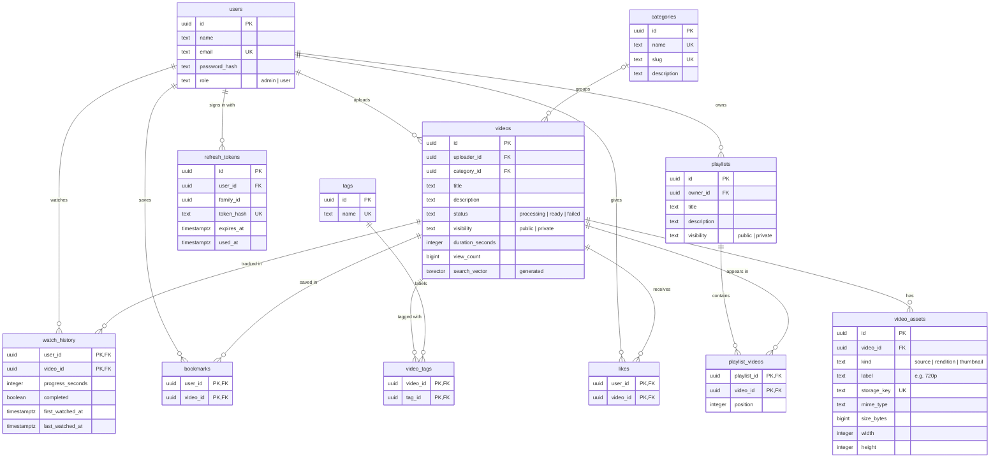

# Database

PostgreSQL 16. The schema is defined in plain SQL migrations in [`server/db/migrations`](../server/db/migrations).

## Entity relationship diagram

Every table also has `created_at`. Tables whose rows can be edited also have `updated_at`, which a shared trigger keeps current.

## Design decisions

- **UUID primary keys** (`gen_random_uuid()`). IDs can't be guessed and don't reveal how many rows exist.
- **Rules are enforced in the database, not only in the API.** `CHECK` constraints cover lengths, allowed values (`role`, `status`, `visibility`, `kind`), lowercase emails and tag names, slug format and non-negative numbers. The API validates the same rules with Zod and returns friendly messages.
- **Metadata and files are kept apart.** `videos` holds what a person edits. `video_assets` holds each physical file (the original, every quality rendition and the thumbnail). Adding a new quality or file type needs no schema change.
- **Storage keys, not paths.** `storage_key` is a relative key such as `videos/<id>/renditions/720p.mp4`. It is never an absolute path or URL, so the storage backend can change without a data migration.
- **One row per user per video** for likes, bookmarks and watch history, enforced by composite primary keys. Repeating "like" changes nothing. Progress is saved with an upsert.
- **Search is built in.** `search_vector` is a generated column that weights the title (A) above the description (B). A GIN index makes full-text search fast.

## Tables

| Table             | Purpose                                                                                      |
| ----------------- | -------------------------------------------------------------------------------------------- |
| `users`           | Accounts. `role` is `admin` (manages content) or `user` (watches and interacts).             |
| `categories`      | Subject areas used to group and filter videos. `slug` is used in URLs (`web-development`).   |
| `videos`          | Video metadata, processing status, visibility, duration and view count.                      |
| `video_assets`    | Files that belong to a video: `source`, `rendition` (one per quality label) and `thumbnail`. |
| `tags`            | Lowercase keywords for filtering at a finer level than categories.                           |
| `video_tags`      | Links videos and tags (many-to-many).                                                        |
| `playlists`       | User-owned, ordered collections of videos, `private` by default.                             |
| `playlist_videos` | Which videos are in a playlist, and in what order (`position`).                              |
| `likes`           | One like per user per video.                                                                 |
| `bookmarks`       | Videos a user saved (favourites).                                                            |
| `watch_history`   | Latest playback position per user and video, and whether the video was finished.             |
| `refresh_tokens`  | Login sessions. Only SHA-256 hashes are stored. Tokens are single-use and rotated.           |

## Delete behaviour

| Relationship                                                                                      | On delete  | Why                                                                                  |
| ------------------------------------------------------------------------------------------------- | ---------- | ------------------------------------------------------------------------------------ |
| `videos.uploader_id` → `users`                                                                    | `RESTRICT` | Removing an uploader must be handled deliberately, so their files aren't left behind |
| `videos.category_id` → `categories`                                                               | `SET NULL` | Deleting a category leaves its videos uncategorised; they are not deleted            |
| `video_assets`, `video_tags`, `playlist_videos`, `likes`, `bookmarks`, `watch_history` → `videos` | `CASCADE`  | Deleting a video removes everything attached to it                                   |
| `playlists`, `likes`, `bookmarks`, `watch_history`, `refresh_tokens` → `users`                    | `CASCADE`  | A user's personal data goes with the account                                         |

## Indexes

| Index                                                        | Serves                                                          |
| ------------------------------------------------------------ | --------------------------------------------------------------- |
| `videos_search_vector_idx` (GIN)                             | Full-text search                                                |
| `videos_public_library_idx` (partial)                        | The main library query: `ready` + `public` videos, newest first |
| `videos_uploader_id_idx`, `videos_category_id_idx`           | Foreign-key lookups and the category filter                     |
| `video_tags_tag_id_idx`                                      | "All videos with tag X"                                         |
| `playlists_owner_id_idx`                                     | "My playlists"                                                  |
| `playlist_videos_video_id_idx`                               | Cascading deletes and lookups by video                          |
| `likes_video_id_idx`                                         | Like counts                                                     |
| `bookmarks_user_created_idx`                                 | Favourites page, newest first                                   |
| `watch_history_user_recent_idx`                              | History page and "Continue watching", most recent first         |
| `refresh_tokens_user_id_idx`, `refresh_tokens_family_id_idx` | Revoking a user's sessions, or one stolen session family        |

Unique constraints add their own indexes: `users.email`, `categories.name` and `.slug`, `tags.name`, `video_assets.storage_key`, `video_assets (video_id, kind, label)` and `refresh_tokens.token_hash`.

## Playlist ordering

`playlist_videos` has `UNIQUE (playlist_id, position)` declared `DEFERRABLE INITIALLY DEFERRED`. Reordering rewrites every position inside one transaction, and the constraint is checked only at commit. So while the reorder runs, two rows may briefly share a position. When several "add video" requests arrive at the same time, the playlist row is locked, so positions are never duplicated.

## Migrations

| File                                  | Creates                                       |
| ------------------------------------- | --------------------------------------------- |
| `0001_create_updated_at_function.sql` | `set_updated_at()` trigger function           |
| `0002_create_users.sql`               | `users`                                       |
| `0003_create_categories.sql`          | `categories`                                  |
| `0004_create_videos.sql`              | `videos`, full-text search column and indexes |
| `0005_create_video_assets.sql`        | `video_assets`                                |
| `0006_create_tags.sql`                | `tags`, `video_tags`                          |
| `0007_create_playlists.sql`           | `playlists`, `playlist_videos`                |
| `0008_create_user_interactions.sql`   | `likes`, `bookmarks`, `watch_history`         |
| `0009_create_refresh_tokens.sql`      | `refresh_tokens`                              |

The migrator ([`server/src/db/migrator.js`](../server/src/db/migrator.js)) works like this:

- Each file runs in its own transaction, and is recorded with a checksum in a tracking table.
- If an already-applied file is edited, the migrator stops with an error. To change the schema, add a new migration; don't edit an old one.
- A PostgreSQL advisory lock stops two processes from migrating at the same time.

## Seed data

| File                  | Adds                                                          |
| --------------------- | ------------------------------------------------------------- |
| `0001_categories.sql` | 8 categories (Web Development, Programming, Databases, …)     |
| `0002_tags.sql`       | 10 common tags                                                |
| `0003_demo_users.sql` | `admin@example.com` and `user@example.com` (development only) |

All seeds can be run again safely (`ON CONFLICT DO NOTHING`). `npm run seed:media` also adds 8 generated demo videos, sent through the real upload and processing pipeline.
